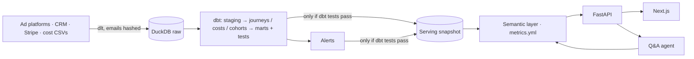

# CACLens

> Channel-level CAC, LTV:CAC and payback analytics that join ad spend, CRM and billing data, with plain-English Q&A.

**Concepts:** `CAC`

CACLens pulls spend from ad platforms (Google, Meta, LinkedIn), costs from payroll/tools, leads and deals from CRM (HubSpot/Salesforce) and revenue from Stripe. It builds a unified customer journey table, applies attribution models, and computes fully loaded CAC, LTV, LTV:CAC and payback by channel, segment and cohort. It alerts on CAC spikes and answers questions like 'why did paid social CAC jump in March?'.

## Quick start (demo data, no credentials)

Prerequisites: Python 3.11+ with [uv](https://docs.astral.sh/uv/), Node 20+ with pnpm.

```bash
uv sync && pnpm i
uv run caclens refresh --demo   # synthetic data -> dbt build + tests -> alerts -> publish
pnpm dev                        # API on :8000 and web app on :3000
```

Open <http://localhost:3000>. The demo dataset (Jan 2025 – Sep 2026, ~3.5k customers) has a story built in: in March 2026 a new Meta lookalike audience brings in low-quality leads, so paid social CAC jumps. Try **Ask → "Why did paid social CAC jump in March?"**, open **Alerts** to see the cost-per-opportunity warning that fired a week into it, and tick **Fully loaded** on the Overview to see Meta's LTV:CAC fall below 2x.

To run it under the orchestrator instead: `uv run dagster dev`, then materialize the `daily_refresh` job (it is also scheduled daily at 06:00 UTC).

## What's in the box

| Requirement | Where |
|---|---|
| FR-01 Connectors: Google Ads, Meta, LinkedIn, HubSpot, Salesforce, Stripe, payroll and tool CSVs | `pipelines/sources/`, loaded incrementally with dlt (`pipelines/load.py`) |
| FR-02 Unified journey and identity stitching (CRM id → hashed email → company domain) | `dbt/models/journeys/`, `marts.customer_journeys` |
| FR-03 Blended, paid and per-channel CAC with a fully loaded toggle | `dbt/models/costs/` allocation rules + `semantic/metrics.yml` |
| FR-04 Cohort LTV with gross margin, payback months and curves | `dbt/models/cohorts/`, `/v1/metrics/payback`, Cohorts screen |
| FR-05 First, last, linear, time-decay and position-based attribution, compared side by side | `journeys/fct_attribution`, Attribution screen |
| FR-06 CAC spike alerts with CPC × CVR decomposition | `api/analytics/alerts.py`, `decomposition.py`, Alerts screen |
| FR-07 Natural-language Q&A over the semantic layer (never raw SQL) | `api/qa/` (Claude tool use + offline planner), `evals/qa_questions.yml` |
| FR-08 Budget optimiser from marginal CAC curves | `api/analytics/optimiser.py`, Budget optimiser screen |



## Repository layout

```text
pipelines/       connectors (sources/), demo data, dlt loader, publish step, Dagster definitions, CLI
dbt/             models (staging, journeys, costs, cohorts, marts), seeds, macros, reconciliation tests
dbt_project.yml  dbt project (at the root so `dbt build` works from here); profiles.yml beside it
semantic/        metrics.yml: every metric defined once
api/             FastAPI app, semantic-layer compiler, analytics (alerts, cohorts, optimiser), Q&A agent
web/             Next.js app
evals/           Q&A eval set (100 questions with expected queries)
tests/           unit tests + an end-to-end integration test
```

## Using real data

1. `cp .env.example .env` and fill in the connectors you use (unset ones are skipped). Set `CACLENS_DEMO=false`.
2. Map your teams to channels in `dbt/seeds/cost_allocation_rules.csv` and your UTM conventions in `dbt/seeds/channel_mapping.csv`.
3. Run `uv run caclens refresh` (or let the Dagster schedule run it). The first run backfills from `CACLENS_BACKFILL_START` (default 2024-01-01); later runs are incremental.

Emails are SHA-256 hashed inside the loaders, so plaintext never reaches the warehouse. Connectors only need read scopes.

## Q&A

With `ANTHROPIC_API_KEY` set, questions go to Claude (`claude-opus-5-5`, override with `CACLENS_QA_MODEL`) with three tools: `query_metric`, `explain_cac_change` and `list_dimension_values`. None of them accepts SQL, and every value is a bound parameter. Without a key, an offline rule-based planner answers instead. Either way the answer comes with a chart and the exact queries it ran.

```bash
uv run caclens ask "Which channel's CAC grew most this quarter and why?" -v
uv run caclens eval                   # offline planner: 99/100 on the demo data
uv run caclens eval --planner claude  # same 100 questions against Claude (uses your API key)
```

## API

| Method | Endpoint | Purpose |
|---|---|---|
| GET | `/v1/metrics` | Metric and dimension catalogue (from `metrics.yml`) |
| GET | `/v1/metrics/{metric}?by=channel&period=month` | Any metric, sliced and over time; `fully_loaded`, `attribution`, `filter=dim:op:value` |
| POST | `/v1/metrics/query` | Full structured query (several metrics, filters, ordering) |
| GET | `/v1/metrics/payback?cohort=2026-Q1` | Cohort payback curves |
| GET | `/v1/overview`, `/v1/channels/{channel}` | Screen payloads |
| GET | `/v1/cohorts`, `/v1/attribution/compare` | Retention grid, model comparison |
| GET | `/v1/alerts` | CAC and cost-per-opportunity alerts with drivers |
| GET | `/v1/optimiser?budget=` | Recommended budget reallocation |
| GET | `/v1/data-quality` | Freshness, identity coverage, unattributed share |
| POST | `/v1/ask` | Question → answer, chart and queries used |

Interactive docs at <http://localhost:8000/docs>.

## Development

| Command | What it does |
|---|---|
| `uv sync && pnpm i` | Install |
| `uv run caclens refresh --demo` | Demo data → dbt build → alerts → publish |
| `uv run dagster dev` | Pipelines UI |
| `uv run dbt build` | Build models + tests (needs raw data: `uv run caclens load --demo`) |
| `pnpm dev` | API + web app (`pnpm dev:web` / `pnpm dev:api` for one) |
| `uv run pytest` | Unit + integration tests (`-m "not integration"` for the fast set) |
| `uv run ruff check .` · `pnpm lint` · `pnpm typecheck` | Linters |

## Docs

| File | Contents |
|---|---|
| [BRAIN.md](BRAIN.md) | Concept primers, research, experiments, decision log |
| [CLAUDE.md](CLAUDE.md) | Instructions for AI coding assistants |
| [DESIGN.md](DESIGN.md) | UX flows, screens, wireframes, visual language |
| [PRD.md](PRD.md) | Problem, users, requirements, metrics, roadmap |
| [SYSTEM_ARCHITECTURE.md](SYSTEM_ARCHITECTURE.md) | Components, data flow, deployment, failure modes |
| [TECHNICAL.md](TECHNICAL.md) | Stack, data models, APIs, algorithms, setup |
