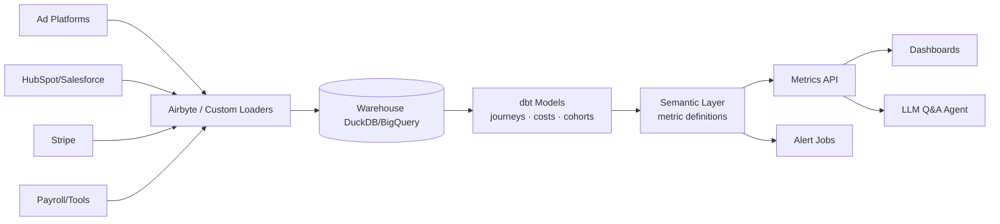

# CACLens: System Architecture

> Channel-level CAC, LTV:CAC and payback analytics that join ad spend, CRM and billing data, with plain-English Q&A.
>
> **Concepts:** `CAC`

## 1. High-Level View

ELT pipeline: connectors load raw data into a warehouse. dbt models build journeys, costs and revenue. A semantic layer defines metrics. The API serves dashboards and the LLM Q&A, which queries only through the semantic layer.

## 2. Components

| Component | Responsibility |
|---|---|
| Loaders | Incremental extracts; schema-on-read raw tables. |
| dbt models | Identity stitching, touchpoints, cost allocation, cohorts. |
| Semantic layer | Metrics as code (CAC, LTV, payback) with dimensions. |
| Q&A agent | Tool-calls `query_metric(metric, dims, filters, period)`. |
| Alerts | Anomaly detection + driver decomposition. |

## 3. Request / Data Flow

1. Nightly load of spend, CRM and billing.
2. dbt builds journeys and attributes customers to channels.
3. Costs allocated (ad spend direct; salaries by channel allocation rules).
4. Metrics computed; alerts evaluated.
5. Users explore dashboards or ask questions.

## 4. Data Stores

| Store | Holds | Why |
|---|---|---|
| DuckDB (MVP) / BigQuery (scale) | Raw + modelled data | Analytics. |
| Postgres | App config, users, alert state | OLTP. |

## 5. Deployment Topology

- Dagster/Airflow for orchestration.
- App on containers.

## 6. Scaling Strategy

- Warehouse scales; semantic queries cached.

## 7. Security & Privacy

- OAuth read-only scopes; PII minimised (hashed emails).

## 8. Observability

- Freshness per source, row-count anomalies, dbt test failures.

## 9. Failure Modes

| Failure | Detection | Response |
|---|---|---|
| Source schema change | dbt tests fail | Pause metric publish; alert data owner. |
